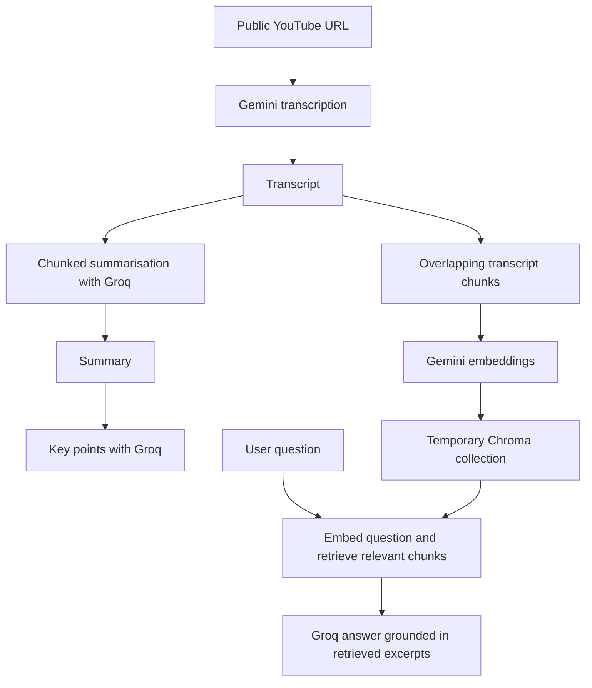

# Video Notes

**Turn a YouTube video into a transcript, a summary, and a searchable source of answers.**

Video Notes is a multilingual Retrieval-Augmented Generation (RAG) application
built with Python and Streamlit. It uses Gemini to transcribe public YouTube
videos and Groq-hosted models to summarise the content and answer questions.
All model and embedding calls use LangChain integrations. Videos are passed
directly to Gemini by URL; the app does not download them.

## Features

- **Transcription:** readable paragraphs in the video's original language.
- **Summaries:** concise summaries in the original language, English, or Hindi.
  Long transcripts are split and summarised in stages.
- **Key points:** up to six distinct bullet points extracted from the summary.
- **Video Q&A:** semantic retrieval finds relevant transcript passages before
  the model answers. Answers follow the language of the question.
- **Separate workspaces:** each video's temporary Chroma collection is isolated
  from other users' collections.
- **Downloads:** save transcripts, summaries, and key points as text files.
- **Demo controls:** request timeouts and bounded inputs and chat history.

## Tech stack

| Component | Technology |
| --- | --- |
| Language and interface | Python 3.11, Streamlit |
| Model orchestration | LangChain, LangChain Expression Language (LCEL) |
| Video transcription | Gemini via `langchain-google-genai` |
| Summaries, key points, and answers | Groq via `langchain-groq` |
| Embeddings | Gemini embeddings |
| Vector search | Chroma via `langchain-chroma` |
| Text processing | RecursiveCharacterTextSplitter, tiktoken |
| Environment and configuration | uv, python-dotenv, Streamlit Secrets |
| Automated checks | unittest, Streamlit AppTest |

## How it works



Summarisation chunks and retrieval chunks serve different purposes: the first
reduce long text into a summary, while the second preserve local context for
semantic search. Key points use the generated summary, not another video request.

## Project structure

```text
.
├── app.py                       # Streamlit UI and session state
├── core/
│   ├── transcriber.py           # YouTube-to-transcript with Gemini
│   ├── summarise.py             # Chunking and iterative summary reduction
│   ├── rag_engine.py            # RAG chain, answers, and key points
│   ├── vector_store.py          # Embeddings, Chroma, and index cleanup
│   └── settings.py              # Shared input and session limits
├── tests/
│   └── test_deployment.py       # Offline backend and UI regression checks
├── .streamlit/config.toml       # Theme and hosting settings
├── .env.example                 # Configuration template, no real secrets
├── requirements.txt
├── test.py                      # Manual transcription demo
├── test_summary.py              # Manual summary demo
└── rag_test.py                  # Manual Q&A demo
```

The UI calls backend functions; prompts, model requests, embeddings, and index
operations belong in `core/`.

## Run locally

Use Python 3.11 from the project directory:

```powershell
uv venv --python 3.11
.venv\Scripts\activate
uv pip install -r requirements.txt
Copy-Item .env.example .env
# Fill in your API keys and model names in .env, then:
streamlit run app.py
```

Use a Gemini model that supports YouTube video input and a Groq model available
to your account. The model names are configurable because availability and
quotas change. Start with a short public video. Private/unlisted videos are
not supported by Gemini's direct YouTube input.

## Using the app

1. Paste a public YouTube video link and select **Analyze video**.
2. Open **Transcript** to read or download the generated text.
3. In **Summary & key points**, choose a summary language and select **Generate summary**.
4. Select **Extract key points** to get bullet points from that summary.
5. In **Ask questions**, select **Prepare video questions** once to build the
   video's index, then enter a question. Indexing is optional if you only want
   the transcript and summary.
6. Select **New video** to clear the current workspace.

## Deploy on Streamlit Community Cloud

1. Push the source, `requirements.txt`, and `.streamlit/config.toml` to GitHub.
   Do not push `.env`, `.streamlit/secrets.toml`, transcripts, or databases.
2. Create an app, select the repository/branch, and set the entry point to
   `app.py`. In Advanced settings, select **Python 3.11**.
3. Add the following root-level entries in the app's Secrets settings:

   ```toml
   GEMINI_API_KEY = "your-key"
   GEMINI_MODEL = "your-supported-video-model"
   GEMINI_EMBEDDING_MODEL = "gemini-embedding-001"
   GROQ_API_KEY = "your-key"
   GROQ_MODEL = "your-groq-model"
   ```

4. Deploy, then test transcription, summary, key points, and questions with a
   short public video. Test two browser sessions with different videos too.

Root-level Streamlit secrets become environment variables; the backend uses
them in the same way it reads the local `.env`. No database service, ffmpeg,
GPU, or operating-system packages are required. Keep secrets at the root of
the TOML file rather than inside a table.

## Sessions, limits, and privacy

- Each video gets an automatically generated Chroma collection in memory.
  Collections are never reused across users. The UI keeps the RAG chain in
  `st.session_state`, not in a shared resource cache.
- Replacing/resetting a workspace releases its old chain. Python cleanup
  removes that chain's temporary collection when it is no longer referenced.
  Disconnected sessions can remain in server memory until Streamlit releases
  them; cleanup is not necessarily immediate when a browser tab closes.
- Transcripts and chat are temporary. Refreshing/disconnecting can reset a
  session; server restarts clear all in-memory indexes. Download notes to keep
  them. Existing local `chroma_db` files are not read by the web app.
- The transcript limit is 100,000 characters. Questions are limited to 2,000
  characters; only the latest 40 chat messages are retained. These are app
  limits, not promises about supported video duration or provider token limits.
- Transcription is a single Gemini call with a capped output. Incomplete
  responses are rejected. Long videos may fail and should be shortened.
- Free Gemini/Groq quotas are shared across all visitors using your keys.
  Concurrent requests or long summaries can hit rate limits; the UI asks the
  user to retry rather than showing raw provider errors. This is a small demo
  deployment, not a high-traffic service with guaranteed capacity.
- Transcripts/questions are sent to Google/Groq for processing. Do not submit
  sensitive material without considering the providers' data policies.
- Answers use retrieved excerpts, not the entire video or a current fact check.
  Visible chat history is not passed to the model as conversation memory.

## Verification

Run the automated checks without using API credits:

```powershell
python -B -m unittest discover -s tests -v
```

The root `test.py`, `test_summary.py`, and `rag_test.py` are manual API demos,
not the offline test suite. Running those scripts can consume API quota.

The offline suite covers concurrent collection isolation, cleanup, failed
indexing, input limits, incomplete transcription, the minimal workspace, key-point
generation/retry, and the main UI flow. It uses real Chroma with fake embeddings
and model responses; it does not prove that provider credentials, account quotas,
or a particular video are available in a live deployment.

## Troubleshooting

| Symptom | What to check |
| --- | --- |
| Missing Python module | Activate `.venv` and run `uv pip install -r requirements.txt`. |
| Missing configuration | Fill in `.env` locally or root-level Streamlit Secrets when hosted. |
| Authentication failure | Check the relevant API key and model access. |
| API usage limit | Wait for the provider's quota reset. All visitors share your keys' quotas. |
| Incomplete transcript or summary | Retry with a shorter video; output limits can truncate generation. |
| Key-point extraction fails | Generate a summary first, check Groq settings/quota, and retry. |

Start with `streamlit run app.py`, rather than `python app.py`. Restart the
Streamlit server after changing secrets. A failed key-point request leaves the
summary intact and the button available for a retry.

Deployment references: [Streamlit deployment](https://docs.streamlit.io/deploy/streamlit-community-cloud/deploy-your-app/deploy),
[secrets](https://docs.streamlit.io/develop/concepts/connections/secrets-management),
[Gemini video input](https://ai.google.dev/gemini-api/docs/video-understanding).
